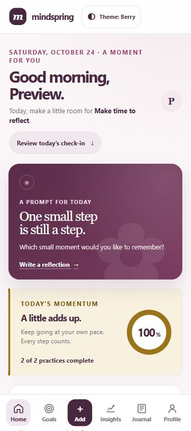

# MINDSPRING

### A gentler way to grow, one small step at a time.

MINDSPRING is a personal self-growth companion for checking in with yourself, building small daily practices, and making room to reflect. It is designed to help progress feel encouraging and personal, without streak pressure or comparisons.



*Responsive web preview. The iOS app uses native navigation and controls.*

## Find your own rhythm

- **Pause and check in.** Record your mood, energy, and an optional note.
- **Choose one small practice.** Add habits and mark the days you complete them, without losing a streak.
- **Grow toward what matters.** Set personal goals and mark them complete when you’re ready.
- **Reflect in your own words.** Use a daily journal prompt and revisit past entries.
- **Notice progress over time.** See a seven-day summary and explore activity from the last 30 days.
- **Make it feel like yours.** Choose Berry, Coastal, or Grove, with light and dark appearances.

Color gives each area a distinct identity, while labels and text keep the app easy to understand. A missed day does not erase the progress you’ve made.

## Web and iOS

The repository includes a responsive React web app and a separate native iOS app built with Expo and React Native. Both share the same core data model, date handling, progress calculations, and theme definitions.

The iOS source release is available on [GitHub Releases](https://github.com/mikeperac-cyber/mindspring/releases/tag/ios-v1.0.0). It is a **source release** and does not include an installable `.ipa`; see the release notes for build requirements.

## Your data stays on your device

MINDSPRING does not require an account. The web app stores data in your browser; the iOS app stores it locally on the iPhone. These stores are separate and do not sync to each other or to a server. The iOS app’s local storage is not encrypted by the app.

## Run the web app

You’ll need Node.js 22.13 or later and npm.

```bash
npm install
npm run dev
```

Vite prints the local address after startup. To create and preview a production web build:

```bash
npm run build
npm run preview
```

## Run the iOS app

The native app targets iOS 16.4 and later. Its source is in `apps/ios`. Start the Expo development server from the repository root:

```bash
npm run ios:start
```

To open the app in an iOS simulator or install it on an iPhone, use a macOS development machine with Xcode and the required signing setup. The exported JavaScript bundle alone is not an installable iOS app.

## Technology

- Web: React, TypeScript, Vite, and React Router
- iOS: Expo, React Native, TypeScript, and Expo Router native tabs
- Shared: TypeScript models, date helpers, progress summaries, prompts, and theme tokens

## Check the project

Run the web and shared-core tests, typechecks, and build from the repository root:

```bash
npm run test -- --run
npm run typecheck
npm run build
```

Run the native iOS checks with:

```bash
npm run test:ios -- --runInBand
npm run typecheck:ios
```

To export the iOS JavaScript bundle, run from `apps/ios`:

```bash
npx expo export --platform ios
```

## Project map

- `src/` — responsive web app
- `apps/ios/` — Expo and React Native iOS app
- `packages/mindspring-core/` — shared models, dates, progress summaries, prompts, and themes
- `docs/audits/` — product flow and responsive UI review captures
